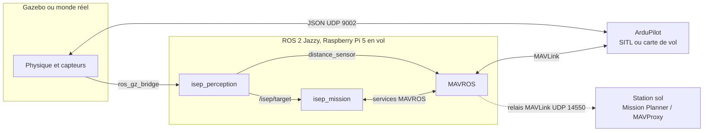

# Architecture

En vol, Gazebo est remplacé par les vrais capteurs et le SITL par la carte de vol : les nœuds ROS 2 restent
identiques, seul le fichier de lancement change (`sim.launch.py` ou `real.launch.py`).

## Topics et services

| Nom | Type | Producteur | Consommateur |
|---|---|---|---|
| `/isep_vtol/camera/image` | sensor_msgs/Image | Gazebo (pont) ou pilote caméra | target_detector |
| `/isep_vtol/lidar/scan` | sensor_msgs/LaserScan | Gazebo (pont) ou RPLidar | (cartographie, à venir) |
| `/isep_vtol/rangefinder` | sensor_msgs/LaserScan | Gazebo (pont) | rangefinder_bridge |
| `/mavros/distance_sensor/rangefinder_sub` | sensor_msgs/Range | rangefinder_bridge ou pilote radar | MAVROS -> ArduPilot |
| `/isep/target` | isep_interfaces/Target | target_detector | mission_node |
| `/isep/mission_state` | isep_interfaces/MissionState | mission_node | station sol, rosbag |
| `/isep/start` | std_srvs/Trigger | opérateur | mission_node |
| `/mavros/state`, `/mavros/extended_state` | mavros_msgs | MAVROS | mission_node |

## Sorties de la carte de vol

| SERVO | Fonction | Rôle |
|---|---|---|
| 1, 2 | 4 Aileron | ailerons gauche, droit |
| 3, 4 | 79, 80 | empennage en V gauche, droit |
| 5 | 33 Motor1 | moteur avant droit (CCW) |
| 6 | 34 Motor2 | moteur avant gauche (CW) |
| 8 | 36 Motor4 | moteur arrière (CCW) |
| 9, 10 | 75, 76 | basculement nacelle avant gauche, droite |
| 11 | 45 | basculement moteur arrière |
| 12 | (à définir) | largage, commandé par la mission (`DO_SET_SERVO`) |

Cette table est générée depuis `isep_vtol.yaml` : la source de vérité est
`ardupilot/params/generated/isep_vtol_servos.param`.

## Décisions
- [0001 : ROS 2 Jazzy et MAVROS](decisions/0001-jazzy-mavros.md)
- [0002 : configuration tilt-tri à lacet vectoriel](decisions/0002-tilt-tri.md)
- [0003 : modèle généré depuis un fichier YAML](decisions/0003-modele-genere.md)
