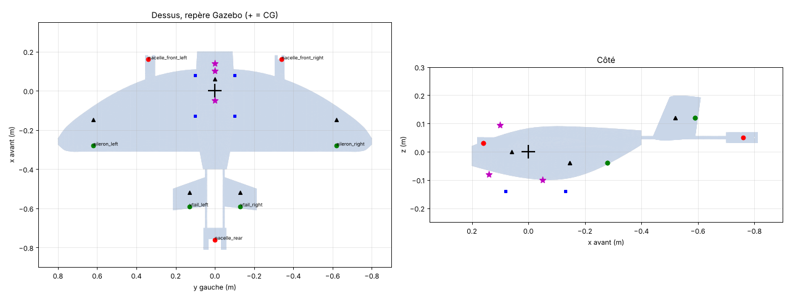

# Le modèle Gazebo isep_vtol

## D'où il vient

```
cad/fusion/fuselage_V1.f3d --(export STL, mm)--> isep_description/models/isep_vtol/meshes/drone_simulation.stl
                                                         |
config/isep_vtol.yaml (masses, moteurs, gouvernes, capteurs) |
                     |                                   |
        scripts/generate_model.py  --------------------->  models/isep_vtol/model.sdf
                     \------------------------------------> ardupilot/params/generated/isep_vtol_servos.param
```

Le STL sert **uniquement à l'apparence**. La physique vient de `isep_vtol.yaml` : masse et inerties,
collisions en boîtes simples, portance par le plugin `LiftDrag` (aile centrale, deux panneaux
extérieurs avec ailerons, deux panneaux du V), poussée par deux « pales » `LiftDrag` par hélice
(méthode des modèles officiels ArduPilot).

## Repères

| | Fusion 360 (le STL, `isep_vtol.yaml`) | Gazebo (`model.sdf`) |
|---|---|---|
| Unité | mm | m |
| Origine | pointe du nez | centre de gravité |
| Avant | −Y | +X |
| Gauche | +X | +Y |
| Haut | +Z | +Z |

Les positions de `isep_vtol.yaml` se lisent directement dans Fusion (Inspecter > Mesurer).

## Mettre à jour après une modification de la CAO

1. Fusion : clic droit sur le corps > Enregistrer en tant que maillage > STL, unités mm. Remplacer `meshes/drone_simulation.stl` (et `cad/export/`).
2. Si les nacelles, le moteur arrière ou les gouvernes ont bougé : mettre à jour `pivot_mm`, `hinge_mm`, `cp_mm`.
3. Fusion > Inspecter > Propriétés sur l'assemblage complet : reporter masse, centre de gravité et inerties dans `mass:` (attention à l'ordre des axes, voir le tableau ci-dessus).
4. `python3 ros2_ws/src/isep_description/scripts/generate_model.py`, puis refaire la validation de [simulation.md](simulation.md#valider-le-modèle-isep_vtol).

## Hypothèses à confirmer

| Donnée | Valeur utilisée | Pourquoi c'est important | Comment la mesurer |
|---|---|---|---|
| Centre de gravité | 200 mm du nez | Mesuré sur le STL : quart de corde moyenne à 198 mm. Avec l'empennage, le point neutre est estimé vers 220 mm. **À 285 mm (ancienne CAO), le drone serait instable en tangage.** | pesée sur deux balances, ou Fusion avec matériaux réels |
| Poussée max par moteur | 26 N (EMAX ECOII 3115 800KV, 10x6, 6S) | En stationnaire, chaque nacelle avant porte 17,4 N, soit 67 % du max : 33 % de marge pour manœuvrer | banc d'essai (`bench/`) |
| Inerties | Ixx 0,25 ; Iyy 0,27 ; Izz 0,52 kg·m² | réglage des gains de stabilisation | Fusion > Propriétés |
| Hélice arrière / empennage | en VTOL, le disque de 10" passe ~2 cm derrière et ~4 cm sous le bord de fuite du V (en croisière, il est 20 cm derrière) | risque de contact ou de perturbation | vérifier dans Fusion avec le moteur suspendu |
| Courant moteur | ESC 40 A | une 3115 sur 6S en 10" peut dépasser 40 A à pleins gaz | banc d'essai, à pleins gaz |
| Train d'atterrissage | 4 points fictifs 40 mm sous le fuselage | contact au sol en simulation | à dessiner dans la CAO |

## Limites connues

- Les gouvernes ne sont pas visibles (STL d'un seul bloc). Exporter les ailerons et le V séparément pour les voir bouger.
- La traînée du plugin `LiftDrag` est proportionnelle à l'incidence, sans traînée de forme : la puissance de croisière simulée est optimiste.
- `AP_MotorsTri` suppose un tri symétrique ; notre moteur arrière est loin derrière (76 cm contre 16 cm pour l'avant). Le terme intégral compense en stationnaire. Si le réglage s'avère difficile, passer à une matrice de moteurs personnalisée (`Q_FRAME_CLASS 15`, script Lua).

## Vérification visuelle

Positions générées (repère Gazebo) superposées au STL : nacelles en rouge, gouvernes en vert,
centres de poussée aérodynamique en triangles, capteurs en étoiles, train fictif en carrés bleus,
centre de gravité en croix.


